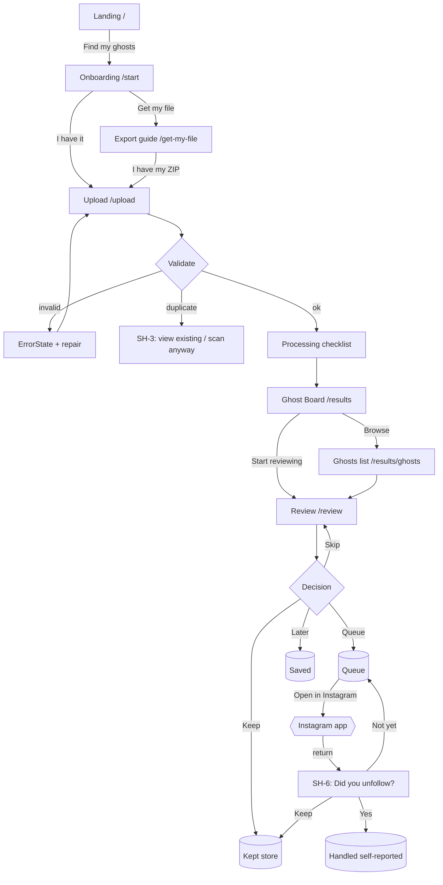
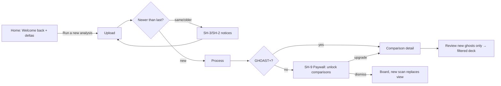

# GHOAST — Product UX/UI Master Design Specification

**Version:** 1.0 (Design Authority Document)
**Date:** 2026-09-30
**Author:** Lead Product Designer / UX Researcher / Interaction Architect (independent redesign)
**Input:** Supplied 12-screen mobile prototype ("v0 concept"), verbal product brief
**Status:** Implementation-ready concept specification. No code written. No repo consulted (by design).

---

## 0. Document Conventions

- **MUST / SHOULD / COULD** follow RFC-2119 semantics for engineering.
- Screen IDs use the pattern `S-xx`; components `C-xx`; tokens `T-`; flows `F-xx`.
- All recommendations trace to one of: (a) prototype forensics, (b) stable external knowledge, (c) product-design reasoning labeled as such.
- **Assumptions are marked `[ASSUMPTION]`** so engineers can challenge them explicitly.

---

## 1. Executive Design Thesis

GHOAST is a **privacy-first relationship intelligence tool** that turns the only data Instagram willingly gives users — the official "Download Your Information" export — into a calm, honest, user-controlled cleanup workflow.

The supplied prototype has five genuinely strong ideas worth protecting: (1) the ghost metaphor and mascot, (2) the export-instead-of-password trust architecture, (3) a guided walkthrough for obtaining the export, (4) a one-account-at-a-time cleanup mode with an honest "do it yourself on Instagram, then confirm" loop, and (5) comparison deltas for returning users.

It also has three structural problems that would damage trust and retention if shipped:

1. **It presents data that the export cannot provide.** The prototype shows avatars, full names, follower counts, verification, and account-type labels ("Personal account", "Creator", "Business account") on result rows. Instagram's followers/following export contains **username, profile URL, and relationship start timestamps — nothing else.** There is no safe, authorized way to enrich this at scale. Shipping this prototype's result rows would require either scraping (violates Instagram terms, risks user accounts, violates our own trust premise) or fabricating (unforgivable). This single constraint reshapes the classification, ranking, and confidence model below.
2. **It hard-paywalls the payoff.** The journey is upload → "527 ghosts found" → 3 teaser rows → paywall. Users who just handed over a personal archive meet a locked door before a single complete insight. That converts curiosity into resentment and invites refund requests and 1-star "scam" reviews — the exact failure mode that plagues this app's category.
3. **Its terminology is cute before it is clear.** "Good Ghosts" is an oxymoron; "Needs Review" becomes "Review" in chips; "Ghosts" ambiguously means both "people who don't follow you back" and "accounts worth removing." Cleverness at the taxonomy layer is a tax paid on every screen downstream.

**The redesigned thesis in one paragraph:** GHOAST reads your Instagram export entirely on your device, shows you the complete picture of who doesn't follow you back — organized by *relationship age and evidence, not invented signals* — lets you make fast, reversible decisions in a focused triage mode, walks you through acting on those decisions yourself inside Instagram at a safe pace, and then, uniquely, **verifies the results on your next scan** and shows you how your graph changed. Free users get one complete, fully-usable scan. Paying users get the memory of the product: history, change detection, comparisons, and protected-list persistence. The ghost is a friendly finder, not a grim reaper — the brand is calm, honest, and slightly playful, and it never pretends to know something the data doesn't say.

---

## 2. Interpretation of the Supplied Prototype (Phase 1 — Visual Forensics)

### 2.1 Screen-by-screen reading

| # | Screen | What it's attempting | Observations |
|---|--------|----------------------|--------------|
| 01 | Landing | Brand intro, primary CTA, trust anchor | Strong headline ("Your Instagram has ghosts."). Ghost + Instagram glyph illustration is ownable. Three trust chips at bottom (Private/secure, Smart recommendations, You're in control) are doing real work. "Sign in" conflicts with the no-account privacy story — unexplained. |
| 02 | Trust & Privacy | Pre-commitment reassurance | Correct content (no password, temporary processing, user control). Arrives one screen too early — the user hasn't been told *what* will be processed yet. "How GHOAST handles my data" link is a good pattern, keep. |
| 03 | Get Your Instagram File | Bridges intent → export acquisition | Good framing ("GHOAST reads that copy — not your password"). Dual path ("I already have my ZIP" / "Show me how") respects returning users. "Takes about 2 minutes" is optimistic — Meta currently takes minutes-to-days to *deliver* the export via email/link; setting that wrong expectation is a real UX debt. |
| 04 | Instagram Guide | Step-by-step export instructions (1 of 4) | Right idea. Current real-world path (Accounts Center → Your information and permissions → Download your information → select profile → followers/following → JSON → device) is longer and on a different surface than shown. Embedded phone-in-phone mock is a nice teaching device. Missing: "what format to choose", "how long delivery takes", "where the file arrives". |
| 05 | Upload | File ingestion | Correct call: accept the ZIP as-is ("Don't unzip it"). File chip with size + remove is good. No handling visible for wrong file, oversized file, HTML-format export, or multi-file exports. |
| 06 | Analysis | Processing feedback + result tease | The step checklist ("Finding followers → Matching relationships → Looking for ghosts → Protecting likely good follows") is an excellent comprehension pattern — keep it. "2,841 relationships" sets scale honestly. Teasing "527 ghosts found" *inside* processing is a warm emotional beat. |
| 07 | Free Reveal | Teaser → paywall trigger | Three tiers (Likely 164 / Needs Review 211 / Good 152) with three example rows. This is the paywall screen and it's too thin: three rows is not an aha moment, it's a hostage note. Bell icon unexplained. |
| 08 | Purchase | Plan selection | One-time $9.99 vs $4.99/mo GHOAST+. Clean comparison. But "See the complete analysis and clean this snapshot" as the one-time tier's promise means free users never see their own data in full — the core trust inversion. Also: selling "smart recommendations" for data we can't verify (account types, follower counts) overclaims. |
| 09 | Full Results | The master list | Tab bar appears for the first time (Home, Results, Cleanup, Saved, Settings) — the app's true skeleton. Filter chips map to the reveal tiers. Rows show avatar/name/follower-count/account-type chips — **the data problem surface.** "View on Instagram" + "Keep" as row actions is the right action model: GHOAST decides nothing, user acts on Instagram. |
| 10 | Cleanup Mode | Focused triage | Best screen in the set. One card, evidence list, progress "12 of 164 reviewed", "Open Instagram ↗" primary, "Keep instead" secondary, honest footnote about returning to confirm. This is the product's soul. Missing: skip/not-sure, undo, batch, pacing guidance. |
| 11 | Completion | Session summary + next action | "86 removed / 41 kept / 37 still waiting" is a satisfying ledger. BUT: "removed" is unverified self-report — dishonest until a re-scan confirms. Contains a typo ("GHOST+" vs "GHOAST+") and buries a paid feature (snapshot memory) in completion — correctly placed upsell, poorly framed. |
| 12 | Returning User | Change-aware home | Exactly the right returning-user concept: deltas vs last scan (+73 followers, −31 followers, +18 new ghosts, +14 became mutual). This is the retention engine and the honest justification for a subscription. Tab bar here differs (Home, History, Settings) from screen 09 — navigation inconsistency. |

### 2.2 Implied navigation (as drawn)
Onboarding stack (01–05) → processing (06) → reveal (07) → paywall (08) → authenticated app with tabs (09–12). Tab bars are inconsistent across screens (5-tab vs 3-tab), implying the prototype explores moments, not a system.

### 2.3 Implied data model (as drawn)
`Relationship { username, fullName, avatar, followerCount, accountType, verified, badge: LikelyGhost|GoodGhost|NeedsReview, reason[], userState: kept|queued }`, `Scan { date, totalGhosts, cleared }`, `Comparison { deltas }`, `Plan { oneTime, monthly }`. **More than half of the Relationship fields are not available in an Instagram export** — see §3.2.

### 2.4 Intended primary vs secondary actions
Primary line: Find my ghosts → Continue → (guide) → Upload → Analyze → Show me → Unlock → Clean up → Open Instagram → confirm. Secondary: Skip guide, Keep, View on Instagram, Save, Finish for now. The primary line is coherent until screen 07, where "Unlock" hijacks the flow.

### 2.5 Missing states (all absent from prototype)
Empty results; zero ghosts; malformed/wrong/duplicate files; HTML-format exports; oversized exports; refresh/interruption during processing; outdated export; deleted/renamed accounts; undo; network failure (if anything is server-side); paywall declined; signed-in vs anonymous dichotomy; delete-my-data flow.

### 2.6 Inconsistencies & confusing terminology
- "GHOST+"/"GHOAST+" typo (screen 11).
- "Needs Review" → "Review" chip; "Likely Ghosts" → "Likely"; "Good Ghosts" → "Good" — three labeling systems for one taxonomy.
- "Good Ghost" is an oxymoron that trains users to distrust the classification.
- Two different tab bars (09 vs 12).
- "Sign in" on landing vs "no account needed" story.
- "Takes about 2 minutes" vs Meta's real delivery latency.
- "Removed" (verified-sounding) vs "self-reported" (reality).
- Cleanup counts 164 (Likely only) while reveal says 527 (all ghosts) — scope of "cleanup" undefined.

### 2.7 Visual strengths to preserve
Ghost mascot with personality; spectral-violet-on-ink palette as brand equity; checklist processing screen; single-focus triage card; change-delta returning home; honest "you do the unfollowing" posture.

### 2.8 Concepts that appear unfinished
Classification evidence model; saved/for-later system; whitelist/protection mechanics (mentioned only in a pricing bullet); history surface; comparison detail; settings/data controls; desktop story (exports are often downloaded on desktop); what "sign in" means; verification loop after cleanup.

### 2.9 Verdict
Keep the skeleton, the mascot, the triage mode, and the change-detection spine. Replace the taxonomy, the data model, the reveal/paywall sequence, the navigation system, and every row of metadata that the export can't substantiate.

---

## 3. Research Findings (Phase 2)

### 3.0 Research limitation (stated honestly)
**Live web research tools were unavailable in this environment (search requests were cancelled by the tool runtime).** No claim in this document rests on fabricated citations. Section 3 uses (a) stable, well-established facts about Instagram's platform (change-insensitive), and (b) explicit product-design reasoning. Engineers/stakeholders should re-verify dated facts (export UI paths, Meta delivery times) against current Meta Help Center before launch content is finalized. Anything time-sensitive is marked `[VERIFY]`.

### 3.1 Stable external knowledge used

**Instagram "Download Your Information" (DYI).**
- Requested via Accounts Center → "Your information and permissions" → "Download your information", or instagram.com/download/request on web. `[VERIFY]` current labels in Help Center.
- Export is profile-scoped and typeable — users can select "Followers and following" only, in **JSON or HTML**, delivered as a download link by email / in-app, typically within minutes to (for large accounts) hours/days. `[VERIFY]` delivery-time copy.
- The ZIP contains `followers_and_following/` with `followers_1.json`, `following.json`, etc. Each entry: `string_list_data[]` with **username (`value`), profile URL (`href`), and `timestamp` of the relationship starting**. No avatar, no display name, no follower counts, no privacy/verification flags, no engagement data.
- Large accounts: files are split (`followers_1.json`, `followers_2.json`…); exports expire (~days) and must be re-requested if missed.
- HTML exports render the same association data but are harder to machine-parse; GHOAST SHOULD accept JSON and gracefully downgrade/refuse HTML with guidance.

**Instagram Platform/API reality.**
- Instagram's official APIs do not offer consumer access to arbitrary other-users' follower graphs; the legacy platform API was shut down years ago; remaining APIs are Business/Creator-scoped. Third-party "who unfollowed me" apps historically worked by (a) storing snapshots from authorized API calls (pre-shutdown), or (b) credential/username-password login — which is why that category of app is associated with account locks, bans, and credential theft, and why app-store reviews for the category cluster around "got my account locked" and "asked for my password." This is reasoning from the platform's published posture, not a live citation.
- **Consequence for GHOAST:** export-in, user-executes-actions is not a limitation of our design; it is the *only* safe architecture. The product MUST never ask for Instagram credentials, and copy SHOULD say so plainly, because the category's biggest trust objection is exactly that.

**Meta rate limits on following/unfollowing (widely documented by users).**
- Instagram throttles rapid unfollow bursts (temporary action blocks are commonly reported after tens of unfollows in a short window; thresholds are unpublished and vary by account age). `[VERIFY]` — thresholds are unofficial by nature.
- **Consequence for GHOAST:** the cleanup flow SHOULD pace users (suggest sessions of ~20–30, take breaks, show optional break timer). This turns a platform constraint into a trust feature: "GHOAST keeps you under Instagram's radar by slowing you down."

**Consumer category landscape (pattern-level, from product-category knowledge):**
- *Unfollower apps* (FollowMeter, Unfollowers & Ghost Followers-type utilities): monetize via subscription, lead with counts, weak privacy posture, credential-based — their app-store reviews are a catalogue of the trust objections GHOAST must preempt: credential demand, account locks, inaccurate data, bait-and-switch paywalls.
- *Social analytics for creators* (SocialBlade-type): dashboards of vanity metrics, dark charts — GHOAST should borrow *deltas-over-time* but reject vanity sprawl.
- *Inbox/triage tools* (email clients with snooze/skip, inbox-zero workflows): decision verbs are few, reversible, and keyboard/gesture-accelerated; queues show progress; nothing disappears without a clear verb.
- *Photo cleanup apps* (SwipeWipe/Slidebox-type): one-item full-screen card + left/right decision gestures make large queues feel like a game; completion screens celebrate throughput. Prototype screen 10 already converged on this.
- *Personal finance & photo dedupe apps*: "review later" and "keep" are first-class, *sticky* states; the product remembers decisions — this maps directly to GHOAST's Kept/Saved/Handled ledger and next-scan reconciliation.
- *Privacy-first SaaS* (local-first tools, e.g., local photo organizers, on-device health apps): trust is communicated *at the moment of maximum anxiety* (the upload button), not on a policy page. Copy at the point of action: what's read, what isn't, where it goes, how to make it gone.

### 3.2 The Export Constraint (the single most important research finding)
**Everything GHOAST knows must derive from: two-usernames directionality + relationship start timestamps.** Therefore:
- ✅ Mutual vs non-mutual vs follower-only classification — exact.
- ✅ Relationship duration / staleness ("following since March 2021") — exact, and a genuinely honest ranking signal.
- ✅ New ghosts / new mutuals / users-you-unfollowed across scans — exact (username set diffs).
- ❌ Follower counts, avatars, display names, verified, private/public, business/creator, engagement, "activity" — **not in the export; removed from the design.**
- ❌ "Inactive followers" detection — impossible without scraping; cut from scope (the brief's candidate list included it; it does not belong).
- ⚠️ Deactivated/renamed accounts — appears as "no longer matches"; handled as an explicit edge case (§22).

**Design implication:** GHOAST's intelligence must be built on **relationship topology + time**, not profile metadata. This is not a weakness — it is the product's honesty moat, and it survives any Instagram display/metadata change. Every confidence statement in the UI must be 100% derivable from the export, and the "Why?" panel must show its work.

### 3.3 Pattern relevance summary
| Pattern source | What GHOAST borrows | Why it fits |
|---|---|---|
| Photo-cleanup swipe apps | Full-screen single-item triage, gesture decisions, completion celebration | 500-item queues need game-loop energy |
| Inbox-zero triage | Few reversible verbs, keyboard shortcuts, queue progress, snooze → "Saved" | Decision fatigue management |
| Finance/dedupe tools | Sticky decisions remembered across sessions & new data | Kept list must survive re-scans |
| Creator analytics | Delta-first summaries (+/− since last time) | Retention loop without vanity sprawl |
| Privacy-first SaaS | Point-of-action trust copy; local processing; delete-data affordance in settings | Category trust deficit must be prepaid |
| Download/export wizards (tax software, Google Takeout UIs) | Literal file-name guidance ("it'll be called instagram-…zip"), where-file-arrives guidance | First-time export users are anxious |

---

## 4. Product Definition (Phase 3)

**One-sentence definition:**
> GHOAST turns your official Instagram data export into a clear, honest map of who doesn't follow you back — and a calm, safe, fully user-controlled workflow for deciding what to do about it.

**Primary user segment:** Visibly-followed Instagram users (500–10k following) who feel their following list has become cluttered and want to clean it without risking their account. Skews 16–34, mobile-first, follows across interests (creators, brands, acquaintances).

**Secondary segments:** (a) Creators/small businesses auditing audience quality (care about fans & mutuals too); (b) post-breakup/post-job/post-school life-transition declutterers; (c) privacy-conscious users who refuse credential-based apps and will pay for the local-first posture itself.

**Core problem:** Instagram gives no native answer to "who doesn't follow me back" and no tools to manage a large following list; third-party answers are unsafe, inaccurate, or both.

**Core promise:** *The truth, from your own data, with you in control.*

**Primary job-to-be-done:** "When I look at my following list and feel it's bloated, help me find the relationships that aren't mutual so I can intentionally prune it — safely."

**Emotional job:** Move from low-grade social anxiety ("do these people even care I follow them?") and clutter-guilt to **closure and control**. The completion screen should feel like a clean room, not a kill list.

**Functional jobs:** Discover non-mutuals; see fans; separate recent follows (grace) from long-standing ones; make many small keep/queue decisions fast; protect specific relationships from ever being flagged; act on decisions at a safe pace inside Instagram; verify results later; compare graphs over time.

**Trust proposition:** No Instagram login. No password. Read-only, official-data-only. No third party ever sees the archive. `[MVP: fully on-device processing]`.

**Privacy proposition:** "We can't leak what we never have." Processing happens in the browser/app on the user's device; the ZIP never leaves it; data deletion is a visible, one-tap feature, not an email-to-support.

**Differentiation:** (1) The only category player whose data trail is fully inspectable & deletable by the user; (2) honesty-by-construction — every claim traceable to the export and *shown* as evidence; (3) verification loop (self-report now, re-scan to confirm) instead of pretending actions happened; (4) pacing features that protect the user's Instagram standing instead of encouraging bursts.

**What GHOAST must NOT become:**
- ❌ A credential-connected automation tool (no "we'll unfollow for you").
- ❌ A vanity analytics dashboard (no engagement scores, no "compatibility", no charts-for-charts).
- ❌ A social- judgement engine (no "fake follower", no quality scoring of humans; GHOAST measures *relationship state*, never people).
- ❌ A multi-platform suite at launch (TikTok/X clones wait for validation).
- ❌ A growth-hacked paywall funnel (no dark patterns, no fake countdowns, no crippled free tier).

### 4.1 Product Principles (rank-ordered; when in conflict, higher wins)
1. **Honest over impressive.** Never display data we don't have. Every insight can show its evidence.
2. **The user acts; GHOAST organizes.** No autonomous actions, ever. Decision verbs are user verbs.
3. **Reversible by default.** Every decision is undoable until the user confirms it happened on Instagram — and even then, Kept survives.
4. **Earn trust at the moment of maximum anxiety.** Trust copy lives on the upload button, not in a policy page.
5. **Calm beats clever.** Plain words ("not following back") beat brand words ("Likely Ghost") wherever meaning would suffer. The ghost is seasoning, not the meal.
6. **Few, fast decisions.** The triage loop optimizes decisions-per-minute without rushing; every metric on a screen must be actionable or removed.
7. **Pace protects.** Slow the user where Instagram would punish speed.
8. **Local first, sync by choice.** Anonymous use is full use; account exists only to carry memory across devices/time (paid).

---

## 5. User / Persona Model

| Persona | Context | Goal | Anxiety | Key screens |
|---|---|---|---|---|
| **"Declutterer Dana"** (primary) — 22, follows 1,847, skimmed an unfollower app once and didn't trust it | Life feels cluttered; saw a TikTok about "finding ghosts" | See the real list, prune a few hundred safely | "Will this get my account banned? Will they steal my password?" | Landing trust, upload reassurance, triage, pacing |
| **"Creator Cam"** — photographer, 12k followers, follows 2.9k | Audience quality matters; wants fans surfaced, brands/venues protected from accidental unfollow | Find non-mutuals *without touching business contacts* | Accidentally unfollowing an important contact | Kept/Protected list, fans view, account detail |
| **"Transition Tam"** — post-grad, shared social graph now stale | Wants a clean slate without burning bridges | Quiet cleanup with dignity, paced | Embarrassment ("did you unfollow me?") | Staleness-first sort, pacing, verification loop |

States, not personas, drive most design: **anxious-first-timer**, **decisive-pruner**, **sentimental-keeper**, **returning-monitor**.

---

## 6. Jobs-to-be-Done (functional, prioritized)

1. **JTBD-1 (MVP):** Tell me exactly who I follow that doesn't follow back — provably, from my own data.
2. **JTBD-2 (MVP):** Let me decide quickly, account by account, with enough context and zero pressure, and let me change my mind.
3. **JTBD-3 (MVP):** Never let me accidentally queue someone I care about (protected list; recent-follow grace).
4. **JTBD-4 (MVP):** Walk me through acting on it myself, safely, at Instagram-safe pacing.
5. **JTBD-5 (Post-MVP):** Remember everything, so my second scan shows *what changed* instead of starting over.
6. **JTBD-6 (Post-MVP):** Show me my fans and mutuals so I understand my whole graph, not just the ghosts.
7. **JTBD-7 (Post-MVP):** Prove the cleanup worked (reconciliation).

---

## 7. Information Architecture (Phase 4)

Decision method: each surface earned its place by serving a JTBD, a trust moment, or a platform constraint. Explicitly **excluded**: in-app Instagram browsing, engagement metrics, multi-account support (MVP), auto-scheduled scans (would require credentials — impossible by design), social features, referral loops.

### 7.1 Sitemap

```text
PUBLIC WEB
├── /                     Landing (product truth + trust + CTA)
├── /privacy              How GHOAST handles data (plain language, layered)
├── /how-it-works         Export walkthrough (public version)
├── /pricing              Free vs GHOAST+ (honest comparison)
└── /help                 FAQ: export help, safety, accuracy, refunds

APP (auth optional)
├── /start                Onboarding: welcome → privacy promise → choose path
├── /get-my-file          Guided export walkthrough (4 steps + delivery expectations)
├── /upload               Drop zone / picker / validation / processing
├── /results              Snapshot overview ("Ghost Board"): stats + three lanes
│   ├── /results/ghosts   Ghosts list (filter / sort / search)   ★ core
│   ├── /results/fans     Follower-only list (context lane)
│   └── /results/mutuals  Mutuals (reference lane, collapsed by default)
├── /review               Triage mode (card deck)                ★ core
├── /saved                Saved-for-later workspace
├── /kept                 Protected list ("Never ask again")
├── /account/:username    Account detail sheet (evidence + history + actions)
├── /activity             Decisions ledger (this snapshot): handled/kept/saved/pending
├── /history              Scans timeline (GHOAST+)
│   └── /history/:runId   Comparison detail (A → B deltas)
├── /paywall              Upgrade sheet (context-triggered, dismissible)
└── /settings
    ├── General (appearance, reduced motion, pacing prefs)
    ├── Data (manage snapshots, export decisions CSV, ★ Delete everything)
    ├── Account (optional sign-in / sync, subscription)
    └── About (version, sources of truth, contact)
```

**Bottom nav (mobile, authenticated, post-results):** `Home (results) · Review · Saved · Settings` — 4 tabs, stable everywhere. History, Kept, Activity live inside Home/Settings surfaces, promoted to tabs only in GHOAST+ if usage data justifies. `[ASSUMPTION: tab order testable]`

### 7.2 Why each candidate from the brief's list was kept/cut
Kept: upload/import, validation, processing, analysis summary, non-follow-back list, follower-only (fans), protected accounts (Kept), saved review, cleanup queue (Review/Handled), comparison/history (paid), search/filters/sort, account detail + explanation, settings, data deletion, help, error recovery. **Cut:** inactive/low-engagement (impossible from export), favorites-as-separate-concept (folded into Kept), export-of-results in MVP (CSV decisions export is Post-MVP), task-automation anything.

---

## 8. End-to-End User Journey (Phase 5)

### 8.1 Acquisition → trust → CTA
Landing must answer, within 5 seconds: *what it does* (headline), *how it's safe* (sub: "your Instagram export, read on your device — never your password"), *what it costs me* (CTA: "Find my ghosts — free"). Trust strip beneath CTA: **No login · On-device · You delete it**. No email gate. [ASSUMPTION: marketing site is server-rendered, app is a PWA; anonymous first run is mandatory.]

### 8.2 First use
`Landing → /start` → 3-step intro (problem → privacy promise → "you'll need one file from Instagram") → path choice: **"I have my export"** → upload. **"Help me get it"** → guide. Guide sets honest expectations: request takes ~2 min to make; delivery can take minutes to hours `[VERIFY]`; file arrives by email/in-app; choose **JSON**; select **"Followers and following"** only (faster + less data = more private — a trust win we should *teach*). User can leave and return; `/upload` accepts the file whenever it arrives. Deep persistence: app remembers guide progress locally.

### 8.3 First insight (the aha)
Processing checklist ends not on a paywall but on the **Ghost Board**: following N · followers M · mutuals X · **ghosts Y** · fans Z — each tappable into its lane. The aha is *the real, complete number with the real, complete list behind it, organized by staleness*. Free users see ALL of it. (Teaser-rows pattern from prototype screen 07 is removed.)

### 8.4 Review → decision
User filters (All / Long-standing / Recent / Saved) and either list-reviews rows (Keep ⌄ / Review / Save) or enters **Review mode** (card deck). Decisions sync instantly to the ledger; undo toast after every destructive-ish verb; Kept items vanish from queues forever (unless user un-keeps).

### 8.5 Execution (the hard honesty)
GHOAST cannot unfollow. So: each queued account offers **Open in Instagram ↗** (deep-link to profile; fallback web URL from the export's own `href`). Pacing UI: session counter + gentle "Instagram prefers slow cleanups — take a breather" break sheet after ~25 opens `[VERIFY] threshold language soft: "Instagram may limit very rapid unfollowing"`. On return, app detects foregrounding and asks: **"Did you unfollow @name?"** → `Yes` (Handled ✓) / `Not yet` (stays queued) / `Keep them` (moves to Kept). Self-reported Handled is labeled as such until a future scan reconciles it to **Verified gone**.

### 8.6 Return usage
Next export (user initiates — there is no other honest way): `/upload` detects a new snapshot → runs diff → **Comparison**: new ghosts, became mutual, you unfollowed (verified), new followers, new fans. This is where GHOAST earns its subscription: memory.

### 8.7 Paid conversion (natural, not coerced)
| Trigger | Moment | Why it's fair |
|---|---|---|
| Second scan comparison | User uploads export #2 | Memory is the paid product; first scan proves value |
| History timeline | User taps a past scan | Memory again |
| CSV export of decisions | User wants their data out | Convenience, not hostage-taking |
| Cross-device sync | Same account, two devices | Infrastructure actually costs money |
Free tier keeps: full scan, full lists, triage, cleanup workflow, Kept/Saved, pacing — **forever**. Nothing the user already received is revoked.

---

## 9. Complete Screen Inventory (Phase 6)

(19 primary screens + system sheets. States per screen in §10.)

| ID | Screen | Route | Tier |
|----|--------|-------|------|
| S-01 | Landing | `/` | public |
| S-02 | Privacy (plain-language) | `/privacy` | public |
| S-03 | Onboarding (3 steps) | `/start` | app |
| S-04 | Export guide (4 steps) | `/get-my-file` | app |
| S-05 | Upload / validation / processing | `/upload` | app |
| S-06 | Ghost Board (results overview) | `/results` | app |
| S-07 | Ghosts list | `/results/ghosts` | app ★ |
| S-08 | Fans list | `/results/fans` | app |
| S-09 | Mutuals (collapsed reference) | `/results/mutuals` | app |
| S-10 | Review mode (card deck) | `/review` | app ★ |
| S-11 | Saved | `/saved` | app |
| S-12 | Kept (protected) | `/kept` | app |
| S-13 | Account detail (sheet/page) | `/account/:username` | app |
| S-14 | Activity ledger | `/activity` | app |
| S-15 | History | `/history` | GHOAST+ |
| S-16 | Comparison detail | `/history/:runId` | GHOAST+ |
| S-17 | Paywall sheet | modal | GHOAST+ trigger |
| S-18 | Settings hub | `/settings` | app |
| S-19 | Data management & deletion | `/settings/data` | app |

System surfaces: SH-1 wrong-file dialog, SH-2 export-too-old notice, SH-3 duplicate-snapshot dialog, SH-4 interruption-recovery sheet, SH-5 undo toast, SH-6 confirm-unfollow-return sheet, SH-7 break-pacing sheet, SH-8 delete-everything confirmation, SH-9 paywall sheet, SH-10 first-launch coach marks, SH-11 "why" evidence popover, SH-12 offline banner (processing is local; only paywall/sync need network).

---

## 10. Detailed Screen Specifications

Legend: **Hierarchy** lists top→bottom content order. **States:** E=empty, L=loading, Er=error, S=success variants.

### S-01 Landing
- **Purpose:** comprehension + trust + single CTA. **Intent:** "Is this safe, and does it work?"
- **Hierarchy:** 1) Wordmark + ghost mark. 2) H1: "Your Instagram has ghosts." 3) Sub: "See exactly who doesn't follow you back — using your own Instagram export, read on your device. Never your password." 4) Primary CTA "Find my ghosts — free". 5) Trust strip (3 chips): No Instagram login · Processed on your device · Delete anytime. 6) Mini "how it works" 3-step strip (Get your file → Drop it in → See your ghosts). 7) Footer: Privacy · How it works · Pricing · Help.
- **Secondary:** none above the fold. No email capture. No "Sign in" in nav (MVP anonymous; account link appears only inside Settings post-scan).
- **Mobile/desktop:** single centered column 640px max; ghost illustration below CTA on mobile, right of copy ≥1024px. **States:** static; respects reduced-motion (ghost drift animation → static).

### S-03 Onboarding
- **3 steps:** (1) "Ghosts, explained." (you follow them; they don't follow back — one sentence + diagram). (2) Privacy promise (3 rows: No password / On-device / You can delete everything — each row expandable with one sentence of detail). (3) Path choice: two cards — "Get my Instagram file" / "I already have it".
- **CTAs:** step-level "Continue" / "Skip intro" (top-right, persists). Dots match prototype pattern. Back chevron always available.
- **States:** none beyond standard. Analytics event per step (local, anonymous, Post-MVP dashboards).

### S-04 Export guide (4 steps, matches real Meta flow)
- **Steps:** 1) In Instagram: Profile → ☰ → Accounts Center. 2) "Your information and permissions" → "Download your information". 3) Select your profile → choose **"Some of your information"** → tick **"Followers and following"** → format **JSON** → date range "All time". 4) "Instagram will email a download link — usually within minutes, sometimes longer. When it arrives, come back here." Each step: numbered header, one annotated screenshot `[VERIFY current Meta UI quarterly]`, one-sentence caption.
- **Persistent footer card:** "Waiting on the email? That's normal. You can close GHOAST — we'll be here." + CTA "I have my ZIP →" (always visible).
- **Deep-thought detail:** show the *expected filename pattern* (`instagram-<name>-<date>.zip`) and typical size ("usually just a few MB when you select only followers & following") — file-name literacy cuts wrong-file errors dramatically.
- **States:** step persistence (localStorage); link to re-request help (didn't arrive >48h → Meta help link).

### S-05 Upload ★ (highest-trust screen in the product)
- **Hierarchy:** 1) H1 "Drop your Instagram ZIP here." 2) DropZone (dashed, 200px+ mobile): icon + "Choose ZIP file" button + "or drag it here" (desktop). 3) Trust row directly under the drop zone: 🛈 "Read on this device. Never uploaded. We look at followers & following lists only — nothing else in the archive." 4) After selection: FileChip (name, size, ✕ remove) + primary CTA **"Analyze my file →"**. 5) Sub-note: "Don't unzip it — GHOAST handles that."
- **Validation (client-side, before processing):** is-zip → contains Instagram DYI structure → choose JSON over HTML → expected files present → sizes sane → dedupe via file hash vs stored snapshots.
- **States:** L: processing checklist (keep prototype's 4 steps: Opening your archive → Finding followers → Matching relationships → Looking for ghosts) with *real* progress ticks as parse completes + honest microcopy "Less than a minute — it's all happening here." Er: SH-1 wrong file ("This doesn't look like an Instagram export — it looks like [photos.zip]. Need the right file? → guide"), HTML export ("This export is in HTML. Re-request and choose JSON — here's the 20-second fix →"), corrupted ZIP (retry + guide link), duplicate (SH-3: "This is the same export you scanned on Sep 29 — [View that scan] [Scan anyway]"), too-old (SH-2: "This file is from 62 days ago — numbers may be stale [Continue] [Get a fresh one]"), interruption (SH-4 on reload: "Your analysis was interrupted — re-select `instagram-ana-….zip` to resume").
- **Accept criteria:** `.zip` MIME+extension sniffed; max 2GB guard with copy; multi-file exports (followers_1.json…) merged.
- **Mobile:** full-screen; file picker = native. **Desktop:** dropzone 480px centered; drag-active state border glow + ghost "opens mouth" micro-delight.

### S-06 Ghost Board (results overview) ★ the aha surface
- **Purpose:** complete honest picture in 5 seconds; every number is a door, not a decoration.
- **Hierarchy:** 1) Snapshot label: "Scan of Sep 30, 2026 · 2,841 relationships" (tap → snapshot info popover: file name, export freshness, delete-this-scan). 2) **Hero stat: N ghosts** ("people you follow who don't follow back") with the word "ghosts" getting a one-time coach-mark definition. 3) Stat row (all tappable): Mutuals X · Fans Y · Following total · Followers total. 4) **Three lanes** (cards): **Long-standing ghosts** (following >1y) — "probably where your cleanup lives" · **Recent ghosts** (<30d) — "give these time; still fresh" · **Saved / Kept** — user state counts. 5) Primary CTA: **"Start reviewing"** (enters S-10). Secondary: "Browse the full list".
- **This replaces prototype screen 07 entirely** — no teaser rows, no lock. **States:** E(zero ghosts — genuine celebration: "Zero ghosts. Every account you follow follows you back. ✨" + CTA to fans/mutuals), E(first-run with 100% recent), L(skeleton 300ms max since processing precedes), Er(n/a).

### S-07 Ghosts list ★
- **Purpose:** browse, search, sort, act at speed. **Primary CTA:** enter Review mode (FAB, bottom-right, "Review" with deck icon). **Row actions:** quick menu ⋯ (Keep / Save / View on Instagram / Why?).
- **Row = C-AccountRow:** avatar→**NO** (no avatars from export: use monogram initial tile with hash-derived hue from username — deterministic, pretty, honest) · username (bold) · evidence line: "Following since Mar 2021 · not following back" · state chip if Kept/Saved/Queued/Handled · ⋯ menu.
- **Filter bar (sticky):** chips [All · Long-standing · Recent · Saved here] + sort control (Oldest first ⟳ default — "staleness is the honest proxy" / Newest / A–Z / Z–A) + search (username substring, instant, local).
- **Multi-select:** long-press row → selection mode: checkboxes, sticky bottom action bar (Keep selected · Save selected · Clear). Bulk = power-user feature, visible only in selection mode (progressive disclosure).
- **States:** E(filter yields none → "No ghosts match — clear filters?"), E(zero ghosts handled via S-06 link-back), L(skeleton rows ×8, shimmer 1.2s loop), Er(search crash impossible; n/a), virtualization mandatory >1000 rows. **Counts in chips** ("Long-standing 164") — keep prototype's count-in-chip idea, lose the misleading labels.

### S-08 Fans / S-09 Mutuals
- Same list engine as S-07. Fans evidence line: "Follows you · you don't follow back (since …)". Fans purpose: context + creator value; secondary sort "Newest first". Mutuals: collapsed by default on Board ("1,308 mutuals — relationship is two-way ✓"), full list for reference; no actions except View on Instagram; no triage (nothing to decide).
- **E-fans:** "No follower-only accounts — everyone you follow, follows you, and vice versa."

### S-10 Review mode (card deck) ★ product soul
- **Layout:** top = progress ("38 of 527 · this session") with segmented bar; center = C-TriageCard (monogram + username large + evidence list: "You follow @x · They don't follow back · Following since Mar 2021 · 5+ years non-mutual" + "Why GHOAST surfaced this" popover link); bottom = action bar.
- **Decisions (4 verbs, all reversible):** **Keep** (protect forever), **Queue** (I intend to unfollow — goes to cleanup queue), **Later** (Saved), **Skip** (no decision; stays in queue for next session). Gestures: swipe right Keep, left Queue, up Later, tap card → Instagram profile preview? NO — keep single-task; "View on Instagram" is a small text-button on card. Keyboard (desktop): ←→↑ + K/Q/L/S + U undo + G open profile.
- **Buttons bar:** [Queue] [Later] [Keep] + ⋯ (View on Instagram / Never show again→Keep / Report data issue).
- **Undo:** toast "Kept @sarah.travel — Undo" 4s, plus full reversibility in Activity ledger.
- **Session close:** completion sheet (S-09-summary): Queued n · Kept n · Saved n · Skipped n → CTAs: "Open cleanup queue" / "Done for now".
- **States:** E(queue finished), L(card skeleton), edge(last card → auto completion), ⏸ resume session exactly where left (session state persisted every decision).

### S-11 Saved / S-12 Kept
- Saved: list engine; row action "Resume reviewing" (jumps account to front of deck); bulk resolve. Kept: list engine + toggle-off ("Remove protection → account returns to eligible queues"); Kept is a *sanctum*: nothing in Kept appears in Review, Ghosts default filters, or cleanup queue; Kept survives all future scans; export-date stamps shown ("Protected since Sep 2026"). E-Kept: "Protected accounts live here — people you never want flagged, like your venue or your mom."

### S-13 Account detail (sheet over list / page on desktop 420px)
- **Content:** username + monogram · relationship facts table (You follow them ✓/✗ · They follow you ✓/✗ · Following since date · Member of scans: list) · **Evidence & provenance block**: "Source: your Instagram export, followers_and_following/following.json ✓" · decision history ("Queued Sep 30 → Handled (self-reported) Oct 2 · auto-verified on Oct 5 scan") · actions (Keep / Save / Queue / Open on Instagram / Remove from Kept…). · **Honesty block:** "GHOAST can't see their posts, followers, or activity — only your export. That's the deal that keeps this safe." This panel replaces the prototype's invented metadata row-for-row with *evidence*.
- **States:** renamed/disappeared account variant (§22).

### S-14 Activity ledger
- "This scan" ledger: tabs Handled (self-reported ✓ / verified ✓✓) · Queued · Kept · Saved · Skipped. Every row reversible (Undo → returns to prior state). Purpose: the memory of *this* session's decisions; feed for completion screen; audit trail that replaces "trust us".
- **Completion screen (replaces prototype S-11 copy):** "Session complete — Queued 86 · Kept 41 · Saved 12 · Left for later 37." Copy change: **"Queued" not "Removed"** until verified: "Marked as unfollowed: 12 (you told us) · Verified unfollowed: 64 (from your scans)". This is the honesty delta vs prototype.

### S-15/16 History & Comparison (GHOAST+)
- History: scan cards (date, totals, Δ chips). Comparison detail: 4 delta groups with lists: **New ghosts (+18)** · **Became mutual (14 ✨** — celebrate reciprocity!) · **You unfollowed — verified (64)** · **New followers (+73)** / **Lost followers (−31)**. Lost-followers list = who left (username + when their follow started). **Design note:** presenting "who unfollowed YOU" is the category's famous dopamine hook; GHOAST shows it in History *without* alarm-red styling — calm neutrals, verbs not verdicts. Red reserved for errors only.
- Paywall SH-9: triggered on second-upload ("Unlock comparisons"), history taps, CSV export. Sheet, dismissible, cumulative value line ("Your decisions and scans, remembered"), plans: Monthly $4.99 / Annual $29.99 / **One-time "Forever Ghost Hunter" $9.99 per snapshot?** → **Decision: kill the per-snapshot one-time from the prototype** — it anchors users to per-scan scarcity and conflicts with "memory is the product". Keep Monthly + Annual. `[ASSUMPTION: pricing testable; architecture must not hard-code tiers]`

### S-18/19 Settings & Data
- Settings hub rows: Appearance (system/light/dark) · Motion (reduce) · Pacing (break threshold 10–50, default 25) · Account (sign in to sync — optional, clearly explained) · Data → S-19 · About (How GHOAST knows what it knows · version · contact).
- S-19 Data: list of stored snapshots (delete each) · Export decisions CSV · **Delete everything** (SH-8: type-to-confirm? No — double-confirm sheet: "Delete all GHOAST data from this device? This can't be undone." [Delete everything] red + "Keep my data" — no account data exists server-side for anonymous users, and copy says exactly that: "Your data is only on this device. Nothing to delete on our end because nothing is there.")


---

## 11. Core Analysis Experience (Phase 7)

**Metric philosophy:** five numbers max ever on a screen; each is a verb in disguise.

| Metric | Source | Action it unlocks |
|---|---|---|
| Ghosts (non-mutuals) | following ∩ ¬followers | Review / list |
| Long-standing vs recent split | timestamp diff vs now | Prioritization + grace |
| Mutuals | following ∩ followers | Reassurance (no action) |
| Fans | followers ∩ ¬following | Optional context, creator value |
| Δ deltas (paid) | scan A vs scan B | Monitor loop |

**Relationship taxonomy (the fix for "Good Ghost"):**
```text
Graph = Mutuals ∪ Ghosts ∪ Fans   (disjoint, exhaustive — always explainable)
Ghosts lifecycle: Unreviewed → { Kept | Queued | Saved | (Skipped=still Unreviewed) }
Queued lifecycle: Queued → Handled(self-reported) → Verified(export-confirmed)
Bands (display-only, derived): Recent (<30d) · Settling (30–365d) · Long-standing (>1y)
```
- "Band" thresholds ship as constants in one config; recent ghosts are visually de-emphasized (gray badge "new — give them time") not excluded, because hiding data breeds distrust.
- **No quality/likelihood scores.** The prototype's "Likely/Needs review/Good" implies judgment. Replace with **evidence chips**; sorting by staleness *is* the ranking, and the UI says so: "Sorted oldest first — the longer it's been one-way, the likelier it's clutter." That's an honest sentence.

**Search & filters (S-07 contract):** text search (username), band filter, state filter (Unreviewed/Saved/Queued/Kept-hidden-by-default), sort (Oldest default / Newest / A–Z / Z–A). Filter state persists per session, resets on new scan (announced by a toast: "New scan loaded — filters reset").

**Empty-metric honesty:** if fans=0, Board shows "0 fans — everyone who follows you is mutual." Zero states are informative, never blank.

---

## 12. Review / Triage System (Phase 8) — the design centerpiece

**Design goals:** ≥8 decisions/min comfortable pace; zero irreversible mistakes; decision fatigue actively managed.

**Verb set (final, 4):** Keep · Queue · Later · Skip. Rationale: prototype had 2 verbs (Keep/unfollow-intent); real triage needs a *parking lot* (Later) and a *pass* (Skip). Queue ≠ unfollowed; the UI never blurs that.

**Card content (only true things):** username, monogram, band badge, evidence lines (directionality + date + derived duration), provenance link. Deliberately absent: follower counts, "worth" judgments, photos.

**Interaction contract:**
- Gestures (mobile): ←Queue · →Keep · ↑Later · ↓Skip — ↓ for "skip" mirrors "pass down" and stays thumb-safe… wait, 4-direction swipe conflicts with scroll: card deck is full-bleed, no scroll region, so 4-dir is safe. Edge: gesture hints animate on first 3 cards only.
- Keyboard (desktop): `← Q · → K · ↑ L · ↓ S · U undo · G open on Instagram · ? shortcuts`.
- Undo depth: session-wide via ledger; toast for the last action.
- Batch: list-mode selection (S-07) — Keep/Save bulk ONLY; **Queue is deliberately single-account-by-single-account, no bulk queue.** Rationale: bulk-queuing invites regret spirals and mass-unfollow velocity that Instagram punishes; one-by-one keeps pace human. `[DESIGN DECISION — challengeable, document rationale in code comments]`
- Progress: session counter "38 of 527 unreviewed" + ring/bar; sessions can pause/resume mid-deck (state persisted).
- Not-sure: Later. Protected: Keep. Mistake: Undo/ledger. Nothing can go irreversibly wrong inside GHOAST; the only irreversible act happens in Instagram's app, by the user's hand.

**Anti-dark-pattern guarantees for engineers:** no countdown timers, no shame copy ("they'll never notice you"), no streak-guilt. Completion copy celebrates *decisions*, not removals.

---

## 13. Data Import Experience (Phase 9) — reduced to a checklist

1. **Teach** (S-04): exact taps, exact current labels `[VERIFY]`, JSON not HTML, "some of your information" → followers & following only (less data = faster + more private — say both).
2. **Set expectations:** delivery takes minutes–hours; "you can leave."
3. **Accept** (S-05): ZIP as-is; name-pattern hint; `accept=".zip,application/zip"`; drag-drop desktop.
4. **Reassure at the point of action:** the exact sentence under the dropzone (§25 copy registry), plus a 60-second "what we read" expandable: list the two files parsed; state everything else ignored & unuploaded.
5. **Validate** fast, fail with *specific* repair steps (wrong file / HTML / corrupt / duplicate / stale).
6. **Process** with the visible checklist, real ticks, sub-minute target on 10k relationships (parsing is trivial; throttle animation to ≥1.8s so it doesn't feel dismissive/fake — too-fast processing reads as "they didn't really scan", a known trust quirk).
7. **Recover** from refresh/interruption with file-name-remembered resume sheet (SH-4).

---

## 14. Privacy & Trust UX (Phase 10) — trust as a feature, placed at anxiety peaks

| Anxiety moment | Location | Message (exact placements) |
|---|---|---|
| "Do they want my password?" | Landing hero sub + onboarding step 2 + guide intro | "Never your password. Instagram's own export is all we need." |
| "Where does my file go?" | Under dropzone + processing screen footer | "Read on this device. Never uploaded." |
| "What do you read?" | Upload expandable + Account detail provenance + About→"How GHOAST knows" | "Two lists: followers and following. That's the whole diet." |
| "How do I make it gone?" | Settings→Data; snapshot popover | per-scan delete + Delete everything; double-confirm |
| "Will Instagram punish me?" | Guide end + first cleanup session | pacing education + break sheet |
| "Is this accurate?" | Every list header + Why? popovers | evidence lines + provenance ("Source: your export, file X") |
| "Who are these people?" | About | company/entity block, contact, no fake logos row |

**Architecture statements engineering must honor (they are copy promises):** MVP processing is 100% client-side; the ZIP's bytes never touch a network call; anonymous mode stores state in IndexedDB/localStorage only; sync (paid) syncs *decisions + aggregates*, never the raw archive; telemetry (if any) is event-level, anonymous, and disclosed in /privacy with opt-out. If any of these change, the copy changes first — flags in code review.

---

## 15. Navigation System

**Information scent rule:** within 1 tap of any screen, user can reach: Home (Board), Review, Saved, Settings. Everything else ≤2 taps.
- **Mobile:** bottom tab bar (4): Home · Review · Saved · Settings. Badge on Review = unreviewed count (cap 99+). FAB *not* used on tab screens (redundant).
- **Desktop (≥1024px):** left rail (icon+label): Home · Ghosts · Fans · Review · Saved · Kept · Activity · History(+) · Settings. Main column max 880px. Account detail = route, back-aware.
- **Deep links:** `/upload` entry from email follow-up; `/review?resume` from reminders; every state change URL-reflective where sensible (filters in querystring) so refresh never loses context.

---

## 16. Mobile Experience (Phase 13 mobile half)

- Single-column, thumb-zone actions, 44px+ targets (48 primary).
- Triage deck full-bleed; hardware back = app back (Android contract).
- Sheets for: account detail, paywall, confirmations, break timer.
- Long-press selection with haptic tick (where supported); bulk bar slides up.
- File flow: native picker; "Files"/Downloads guidance chip ("Check Downloads for instagram-*.zip").
- Pull-to-refresh: intentionally absent on lists (data only changes via new upload) — prevents false expectation of live data. **[HONESTY DETAIL]** Instead, Board header shows "Add a newer scan →".

## 17. Desktop Experience (Phase 13 desktop half)

- Same IA, left rail; keyboard-first triage (GHOAST on desktop = rapid review machine).
- Multi-select via click-drag/shift-click, parity with long-press.
- Upload = primary desktop use-case (exports often fetched at a computer); drag-drop delight (ghost inhales file).
- Hover reveals row quick-actions (Keep/Save icons) — progressive, never required.
- No fake "mobile app required" gating anywhere.


---

## 18. Visual Design System (Phase 11)

**Brand personality:** the friendly forensics lab. Calm, witty, exact. The ghost is a helpful bloodhound, not a jump scare. Voice: plain-spoken, zero hype, dry humor *only* in empty/completion states.

**Visual metaphor:** "spectral scan" — a warm-violet beam moving through dark ink, revealing shapes. Used sparingly: processing, hero, completion. Not as chrome.

**Principles:** Ink-calm surfaces · one spectral accent · data wears neutral colors · color never alone carries meaning · motion explains, never decorates.

### 18.1 Color tokens (CSS custom properties, dark & light)
```css
/* Dark (default, brand-forward) */
--ink-0:#0D0A14; --ink-1:#151021; --ink-2:#1F1830; --ink-3:#2A2140;   /* surfaces */
--paper-0:#F7F5FC; --paper-1:#FFFFFF;                                 /* text on ink */
--text-2:#B3ACC9; --text-3:#7E7699;                                   /* secondary/muted */
--spectral-500:#8B5CF6; --spectral-400:#A78BFA; --spectral-300:#C4B5FD;/* brand accent */
--spectral-700:#6D28D9;                                               /* pressed */
--mint-400:#34D399;    /* success / mutual / became-mutual */
--amber-400:#FBBF24;   /* attention / saved / pending */
--rose-400:#FB7185;    /* destructive actions ONLY (delete, queue-confirm?) — queue uses spectral; rose reserved */
--azure-400:#38BDF8;   /* informational / fans */
```
**Light theme:** surfaces invert (#FFFFFF/#F5F3FA/#ECE7F7), text #1A1430/#4A4166, accent deepens to --spectral-700 for contrast (≥4.5:1).
**Rule:** ghosts themselves are **not** red. Rose appears only for destructive/deletion UI. "Ghost" rows are neutral with spectral accents on hover/action. This alone de-aggressifies the category.

### 18.2 Type & scale
- UI: **Inter** (system fallback stack). Display/numerals: **Space Grotesk** for big stats (tabular-nums). 
- Scale (rem): 0.75 / 0.875 / 1 / 1.125 / 1.5 / 2 / 2.5 / 3.5 → names: `caption, micro, body, lead, h3, h2, h1, hero`.
- Weights: 400/500/700 only. Line-height 1.2 display, 1.5 body. `font-feature-settings:"tnum"` in all stats.

### 18.3 Space, grid, radius, elevation
- Spacing: 4pt base → `space-1:4 … space-12:48`. Mobile padding 20; desktop column 880.
- Grid: mobile 4-col/16 gutter; desktop 12-col/24 gutter.
- Radius: `r-sm:8 (chips) / r-md:14 (cards, rows) / r-lg:20 (sheets) / r-full (buttons, badges)`.
- Elevation: dark theme prefers 1px `rgba(139,92,246,.14)` borders + soft shadows (`0 8px 30px rgba(10,6,24,.45)`); sheets +64px top radius r-lg, scrim `rgba(9,6,18,.6)`.

### 18.4 Iconography & illustration
- Icons: Lucide-style 1.5px stroke, 20/24px. Ghost glyph custom: two arcs + dot eyes; used for brand and tab "Home" only.
- Illustration: single ghost character, 4 poses (searching, celebrating, sleeping-empty-state, inhale-upload). Flat with subtle inner glow — **no glassmorphism, no mesh gradients on UI surfaces**; gradient allowed only inside illustration art and processing beam.

### 18.5 Data-viz
- Segment bars (makeup of following), delta chips (+/− with mint/text-3 — **lost-followers are neutral gray, not red**), progress ring in review. Line charts deliberately absent in MVP (2 data points don't deserve a chart).

### 18.6 Component visual language (summary; full specs §19)
Buttons: spectral solid primary (full radius, 52px h), ghost-outline secondary, text tertiary. Chips: r-sm, 1px border, count in tnum. Rows: 64px, monogram 40px tinted circle, 1px separators `ink-2`. Cards: `ink-1` bg, r-md, `ink-3` border. Sheets: over-scrim, drag handle 36px. Dialogs: 340px max, single danger action right-aligned. Notifications: bottom toast with inline Undo (spectral text button), 4s, swipe-away.

---

## 19. Component Library (contract-critical props & states)

| ID | Component | Key props | States |
|----|-----------|-----------|--------|
| C-01 | AppShell (tabs/rail) | activeTab, reviewBadge | default/focus |
| C-02 | DropZone | onFile, accept, error | idle/hover/drag-active/selected/error/processing |
| C-03 | FileChip | name, size, onRemove | default/removing |
| C-04 | StepList (processing) | steps[{label,status}] | pending/active(tick)/done(✓)/failed(✗) |
| C-05 | StatCard | label, value, delta?, to | default/press/skeleton |
| C-06 | LaneCard | title, count, hint, to | default/press/skeleton |
| C-07 | AccountRow | username, evidence[], state?, selected? | default/kept(saved,queued,handled badges)/selected/skeleton |
| C-08 | Monogram | username → initial+hashHue | deterministic, aria-hidden, color-pair passes AA on ink-2 |
| C-09 | FilterBar | chips[], sort, query | default/stuck(top, elevated)/selection-mode swap |
| C-10 | TriageCard | relationship, evidence, onDecision | front/back stack, drag states (tilt 6°, edge glow color of verb), entering/exiting |
| C-11 | ActionBar (triage) | onQueue/Later/Keep, menu | default/disabled(while animating) |
| C-12 | ProgressHeader | done, total, label | determinate, pulse at 100% |
| C-13 | UndoToast | message, onUndo | enter 160ms, hold, exit |
| C-14 | Sheet | title, detent[0.5,0.92] | open/close, focus-trap, scrim-dismiss (except destructive) |
| C-15 | EmptyState | icon(ghost pose), title, body, cta? | variants: no-ghosts, no-results, no-saved, no-history |
| C-16 | ErrorState | title, body, retry?, guide? | wrong-file/html/corrupt/stale variants |
| C-17 | PaywallSheet | trigger, plans, onDismiss, onPurchase | loading/ready/purchasing/success/error(retry) |
| C-18 | DeltaChip | sign, value, label | positive mint / negative neutral-gray (never red) |
| C-19 | EvidencePopover ("Why?") | facts[], source | open/close, focus return |
| C-20 | ProtectedToggle | kept, onChange | toggle with 250ms ghost-peek micro-animation |
| C-21 | CoachMark | target, text | once-only, persisted, skippable |
| C-22 | BreakSheet | elapsed, count, snooze | auto after threshold opens (default 25), dismissible-snooze 10 |

**Interaction rules:** every async CTA shows pressed→loading→result; destructive confirm = explicit sheet; no optimistic UI for anything that later claims verification (Handled stays "self-reported" until reconciled).

---

## 20. Microinteractions (Phase 14) — motion for comprehension

Durations: fast 120–180ms (presses), medium 220–320ms (cards, sheets), slow 400–600ms (processing ticks, hero). Easing: `cubic-bezier(.2,.8,.2,1)` standard; spring (stiffness 260, damping 24) for card fling. **Reduced-motion:** all non-essential motion off; processing ticks fade instead of slide.

Key moments:
- **Upload→processing:** file chip shrinks into ghost's mouth (160ms) → checklist ticks cascade 120ms apart — communicates "it's being read, step by step."
- **Reveal:** ghost count counts up 800ms (tnum), then lanes fade up staggered 60ms — directs the eye stats→lanes→CTA.
- **Triage decision:** card flies toward verb edge, edge glows in verb color (Queue=spectral, Keep=mint, Later=amber), a tiny `+1` ticks the header counter — cause→effect literacy.
- **Undo:** toast slides up; undone card slides *back onto* the deck from its exit direction.
- **Keep (protection):** small ghost icon peeks over the card corner — protected things "get a guardian".
- **Completion:** single confetti burst (≤18 particles, 600ms, respects reduced-motion → static ✓).
- **Break sheet:** gentle fade-in, no modal-jolt; snooze quietly resumes.

---

## 21. Accessibility (Phase 15) — launch blockers, not backlog

- **Contrast:** text ≥4.5:1, large text ≥3:1; spectral-500 on ink-0 = 5.9:1 ✓ (verify programmatically in CI with token pairs).
- **Color independence:** every color-coded state also has icon+label (Kept 🛡, Queued 👻+text, Handled ✓).
- **Keyboard:** full app navigable; triage shortcuts; visible focus ring (2px spectral-400 offset 2px); sheet focus-trap; escape closes non-destructive overlays.
- **Screen readers:** rows announce "username, followed since March 2021, not following back, button"; stats use `<dl>` semantics; live-region for toasts (polite) and processing progress (polite); gestures duplicated by buttons (never gesture-only).
- **Reduced motion:** §20. **Targets:** ≥44×44px mobile; 8px min spacing.
- **Localization-ready:** all copy in strings registry (§25); username rendering LTR-safe with bidi isolation (`<bdi>`); dates via Intl.

---

## 22. Edge Cases (Phase 17) — exhaustive handling table

| Case | Detection | UX response |
|---|---|---|
| Zero ghosts | scan math | Celebration EmptyState; suggest Fans/Mutuals; upsell memory ("scan again later to see change") |
| Thousands of accounts | parse counts | Virtualized lists; deck sessionized (chunks of 50 with "keep going?" — fights fatigue honestly); search instant local |
| Malformed/corrupt ZIP | zip read throw | SH-1 error: retry + guide + "file may have been re-zipped or partially downloaded" |
| HTML-format export | structure sniff | Specific error with 3-step re-request guide; offer "request again →" deep link |
| Duplicate upload | sha-256 of file vs snapshot store | SH-3 dialog: view existing scan / scan anyway |
| Outdated export | File.lastModified & export metadata if present | SH-2 notice, non-blocking, stamp on snapshot ("64 days old") |
| Private accounts | **indetectable from export** | Never claimed. Guide/FAQ explains: "GHOAST doesn't know who's private — and honestly, Instagram's export doesn't say." |
| Missing metadata (no display names/avatars — always) | by construction | Monogram design system; provenance panels own the honesty |
| Username changed | old decision username not in new scan | "Changed or gone" group in comparison: u.username no longer exists; decisions folded with note; no false matching by href (href contains username) — treated as new/unknown, copy: "23 accounts changed their username, deactivated, or were removed — we can't tell which." |
| Deleted/deactivated | same as above | same bucket |
| Previous decisions on re-scan | decision store join | Kept persists everywhere; Queued-but-not-verified shows as "still there 👻"; self-reported Handled that *still appears* → flag "Instagram may still show them — unfollow may not have completed" (empathy, not blame) |
| Partial data (only following.json present) | schema check | Partial mode with visible scope banner: "Showing ghosts only — followers list missing, so fans/mutuals unavailable. [Why?]" — never silently wrong |
| Network interruption | n/a for processing (local); paywall/sync fetchers | Offline banner SH-12; local features unaffected — a selling point surfaced in the banner copy |
| Refresh mid-processing | persisted job state | SH-4 resume sheet with remembered filename; no data loss beyond re-select |
| Re-scan with fewer relationships (mass unfollow elsewhere) | diff math | Comparison handles negative deltas calmly; no panic styling |
| Export includes Threads-adjacent extras | schema filter | Ignore silently; "what we read" list remains true |


---

## 23. Complete User Flows (Phase 16) — Mermaid

### F-01 New user → first analysis


### F-02 Returning user → comparison


### F-03 Review all non-follow-backs · F-04 Search · F-05 Save · F-06 Protect · F-07 Cleanup · F-08 Undo · F-09 Malformed → covered by F-01 branches + ledger; text contracts:
- **F-04 Search:** list → query → row → detail sheet → any verb. Search never navigates away (instant local).
- **F-06 Protect:** row ⋯ → Keep → toast + ghost-peek; appears in /kept; excluded from all future queues & decks & comparisons' "new ghosts" (never re-flagged).
- **F-08 Reverse a mistake:** (a) 4s toast undo; (b) Activity ledger → any row → "Move back to unreviewed"; (c) /kept → "Remove protection". Handled-on-Instagram can't be undone by GHOAST — copy says "You'll need to re-follow on Instagram" with deep link. Honesty over pretending.
- **F-10 Delete imported data:** Settings → Data → Delete everything → SH-8 confirm → wipe IndexedDB + localStorage keys + "done" toast → app returns to /start state. Per-scan delete via snapshot popover.
- **F-11 Free→paid:** first scan untouched; second upload → comparison gate (SH-9) — user may dismiss and get plain new-scan view (value retained, memory withheld, fairly).

---

## 24. UX Copy Registry (Phase 18) — representative strings (voice: calm, exact, lightly warm)

| Slot | Copy |
|---|---|
| Landing H1 | Your Instagram has ghosts. |
| Landing sub | See exactly who doesn't follow you back — from your own Instagram export, read on your device. Never your password. |
| Landing CTA | Find my ghosts — free |
| Onboarding privacy | No password. No uploading your archive. No funny business — just your own file, read right here. |
| Guide expectation | Instagram takes a few minutes — sometimes a few hours — to prepare your file. You can close GHOAST; come back when the email arrives. |
| Guide format tip | Choose **JSON** when Instagram asks. (The other option, HTML, is for reading — not for us.) |
| Guide data-min tip | Pick "Followers and following" only. Smaller file, faster download, and we never see the rest of your life. |
| Upload trust line | Read on this device. Never uploaded. We look at two lists — followers and following — and nothing else. |
| Processing checklist | Opening your archive · Finding your follows · Matching relationships · Meeting your ghosts |
| Board aha | **527** people you follow don't follow back. |
| Board lane hint (long-standing) | Following them over a year, still one-way — start here. |
| Board lane hint (recent) | Recent follows — give these time. People aren't notifications. |
| Deck Why? popover | Why you're seeing this: it's in your export's "following" list, not in "followers", and you followed them {duration} ago. That's the whole reason. |
| Break sheet | Instagram prefers slow cleanups — 25 opens already. Grab some water; your queue will be right here. |
| Return-confirm (SH-6) | Did you unfollow @{username}? / Yes, done ✓ · Not yet · Actually, keep them |
| Completion | Session complete. {n} decisions made — {q} queued, {k} kept safe, {s} saved for later. Nothing happened on Instagram that you didn't do yourself. |
| Zero ghosts | Zero ghosts. Every account you follow follows you back. Genuinely rare — enjoy it. ✨ |
| Wrong file error | This doesn't look like an Instagram export — it looks like "{filename}". Your export is usually named instagram-yourname-{date}.zip. [Show me how to get it] |
| HTML error | This export is in HTML format, which we can't read. Re-request it and choose JSON — it takes about 20 seconds. [Walk me through it] |
| Duplicate | You've already scanned this exact file (on {date}). [View that scan] [Scan it anyway] |
| Stale file | This file is {n} days old — your graph may have changed since. [Use it anyway] [Get a fresh export] |
| Paywall (comparison) | Your graph moved while you weren't looking. GHOAST+ remembers every scan, so you can see what changed — {+18} new ghosts, {14} became mutual. |
| Delete confirm | Delete everything from this device? Scans, decisions, Kept list — all of it, gone. There's no copy on our side to clean up; it was never sent anywhere. |
| Deleted toast | Everything deleted. GHOAST is a stranger again. |
| Handled honesty | Marked as unfollowed — we'll verify it's really gone on your next scan. |
| Verified | Confirmed unfollowed ✓✓ (verified in your {date} scan) |

---

## 25. MVP vs Complete Product (Phase 19)

### Launch MVP (must be true on day 1)
- Public: Landing, Privacy, How-it-works(=guide), Help-lite.
- App: S-03 onboarding, S-04 guide, S-05 upload/validate/process (all error states in §13/§22), S-06 Board, S-07 Ghosts list (filter/sort/search), S-08 Fans, S-10 Review deck (4 verbs, undo, pacing breaks), S-11/S-12 Saved & Kept, S-13 Account detail w/ provenance, S-14 Activity ledger, completion sheet, S-18/19 Settings + Data incl. Delete-everything.
- 100% client-side processing; anonymous; local persistence.
- **Monetization in MVP:** pricing page exists; GHOAST+ purchasable; the ONLY gated thing is *second-scan comparison/history scaffolding* may still be building → gate may return "coming with your next scan"… **No — decide cleanly:** MVP gates **comparisons & history** behind GHOAST+ from day 1 because diffing is the paid core; if history UI isn't built, don't sell yet. Recommended: build minimal comparison in MVP (it reuses the list engine). It's the retention engine; ship it.
- **Not in MVP:** Mutuals full screen (collapsed lane only), CSV export, cross-device sync/account, annual plan, desktop-optimized rail polish (functional desktop OK), coach marks beyond 3.

### Post-MVP (ordered, each gated by its own evidence)
1. v1.1 Cross-device sync + optional account (only syncs decisions/aggregates).
2. v1.2 CSV export of decisions/scans; annual plan ops; localization top-5.
3. v1.3 Reminder system ("time for a fresh scan"), email capture—opt-in only.
4. v1.4 Advanced sort facets (session-position memory, per-band decks), accessibility audit round 2.

### Future possibilities (parked — do not contaminate launch)
- Multi-platform exports (TikTok/X), creator analytics depth, shared "couples/friends" comparisons, automatic re-request helpers (Meta doesn't allow; would always remain manual), AI-written "should I keep them" advice (conflicts with Principle 1+2 unless purely explanatory).

---

## 26. Engineering Handoff (Phase 20)

### 26.1 Routes
As §7.1 sitemap. Meta-routes: `/` + `/privacy|how-it-works|pricing|help` (SSG); app routes client-rendered PWA. Guarded: `/history*` (entitlement check → SH-9).

### 26.2 Stack-agnostic requirements
- PWA, offline-capable; ZIP parsing client-side (e.g., JSZip/FFlate); JSON schema validation layer isolating Meta format drift (`adapters/instagram-dy1.ts` — version it! Meta changes formats; adapter versioning + defensive parsing + "weird export" sampling telemetry(opt-in) is your operational moat); IndexedDB (Dexie-style) stores below.
- No external avatar/profile fetch calls. No Instagram API SDK. CSP blocks remote image by username. (This is architecture-as-policy: engineers *can't* violate the privacy promise.)

### 26.3 Data stores (client, versioned migrations)
```ts
Snapshot { id, createdAt, fileName, fileHash, fileLastModified, counts:{following,followers,mutuals,ghosts,fans} }
Relation { snapshotId, username, href, direction:'following'|'follower'|'mutual', followingSince?:number, followerSince?:number }
Decision { username, state:'kept'|'queued'|'saved'|'handled_self'|'handled_verified'|'skipped', updatedAt, sourceScanId }  // username-keyed, scan-independent
Comparison { id, fromSnapshotId, toSnapshotId, added[], removed[], newGhosts[], becameMutual[], lostFollowers[], newFollowers[], vanished[] }
Settings { theme, reducedMotion?, pacingThreshold:25, seenCoachMarks[], plan:'free'|'plus' }
```

### 26.4 Design tokens
Export from §18 as CSS vars + TS constants; theme via `data-theme="dark|light"`; system default. Tokens CI-tested for AA pairs.

### 26.5 Component build order
C-02/03/04 (upload) → C-07/08/09 (list engine — reused 6×, build once well) → C-05/06/18 (Board) → C-10/11/12/13 (deck) → C-14/15/16/19 (surfaces) → C-17 paywall → C-20/21/22.

### 26.6 Implementation order (two-sprint-shaped)
1. Parse adapter + stores + upload/validation/errors (the *trust* core).
2. Board + list engine + detail sheet.
3. Deck + ledger + Kept/Saved + undo.
4. Execution loop (deep links, return-confirm, pacing).
5. Comparison engine + history + paywall.
6. Polish: motion, coach marks, a11y audit, performance (virtualization at >1k rows; deck memory-safe at 5k cards — only 3 cards mounted).

### 26.7 Acceptance criteria (sample, testable)
- 10k-relationship export processes <8s mid-tier Android; list scrolls 60fps.
- Refresh at any processing step → SH-4 within 1 interaction.
- Zero network requests containing archive bytes (verified by Cypress request-interception test named `privacy-promise.spec`).
- All flows §23 pass on 360×640 and 1440×900; axe-core: 0 critical.
- Every string rendered from copy registry; no hard-coded copy.

---

## 27. Final Recommended Experience (one-paragraph vision)

A wary user lands after being burned by password-grabby apps. Ten words tell them GHOAST is different: *your export, your device, never your password.* Four annotated screenshots get them the file without fear; a dropzone that says exactly what it reads takes the anxiety out of the scariest tap in the product. Ninety seconds later they're looking at the complete, un-paywalled truth — 527 ghosts, sorted oldest-first, every one explainable. Reviewing feels like a calm game: swipe, swipe, save-for-later, protect the venue that books them. A gentle break sheet appears before Instagram would get suspicious. A week later they upload a fresh export and see the only thing competitors sell with a dashboard and a login: *what changed* — 64 verified gone, 14 became mutual, 18 new ghosts. They subscribe, not because a teaser row was locked, but because memory turned out to be worth $4.99. And every pixel that said anything can answer "how do you know?" — with the file, the line, and the date.

**The strongest thing GHOAST can be is the app this category's burned users actually believe. Design, copy, and architecture should each be able to prove the other two.**


